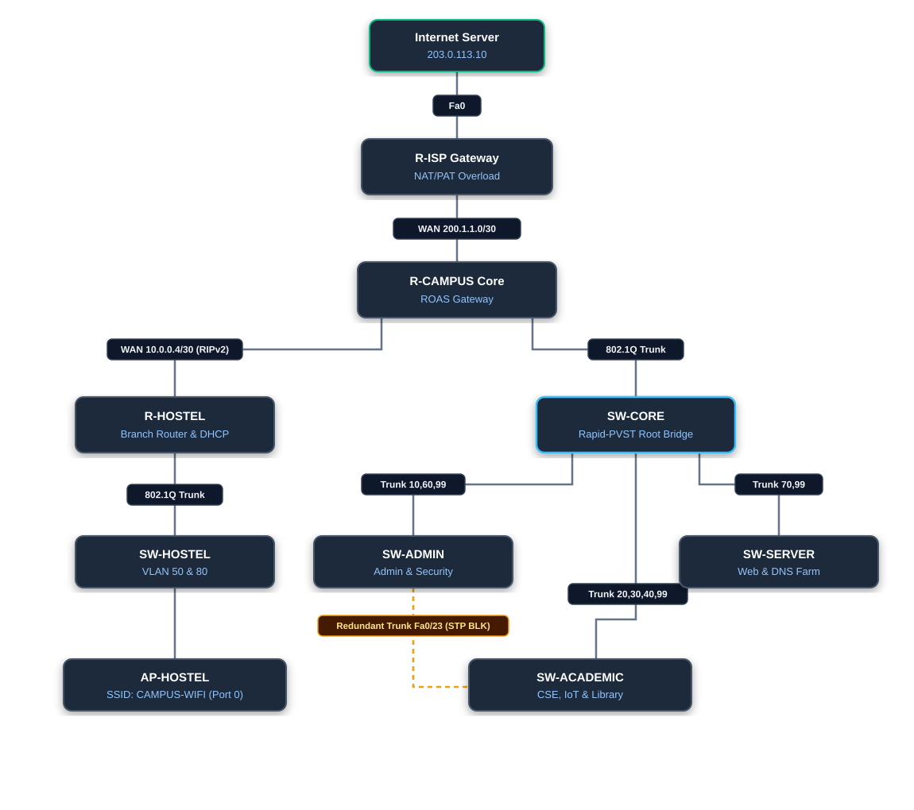

# 🎓 Enterprise University Campus Network Infrastructure
### Production-Grade Cisco Packet Tracer Network Design & Implementation

[](https://www.netacad.com/courses/packet-tracer)
[](https://en.wikipedia.org/wiki/IPv6)
[-green)](https://en.wikipedia.org/wiki/Rapid_Spanning_Tree_Protocol)
[](https://en.wikipedia.org/wiki/Routing_Information_Protocol)
[](https://en.wikipedia.org/wiki/Network_address_translation)
[](#-acceptance-testing--verification-matrix)

---

## 📖 Table of Contents
1. [Project Overview](#-project-overview)
2. [Network Architecture & Topology](#-network-architecture--topology)
3. [Physical Cabling & Port Matrix](#-physical-cabling--port-matrix)
4. [VLAN Segmentation & Subnetting Plan](#-vlan-segmentation--subnetting-plan)
5. [Master Device IP Addressing Table](#-master-device-ip-addressing-table)
6. [Key Technical Implementations](#-key-technical-implementations)
   - [Spanning Tree Protocol (Rapid-PVST 802.1w)](#1-spanning-tree-protocol-rapid-pvst-8021w)
   - [Router-on-a-Stick (802.1Q ROAS)](#2-router-on-a-stick-8021q-roas)
   - [Dynamic Routing (Classless RIPv2)](#3-dynamic-routing-classless-ripv2)
   - [Edge PAT / NAT Overload](#4-edge-pat--nat-overload)
   - [Wireless LAN & Centralized DHCP](#5-wireless-lan--centralized-dhcp)
   - [Dual-Stack IPv6 Deployment & SLAAC](#6-dual-stack-ipv6-deployment--slaac)
7. [Acceptance Testing & Verification Matrix](#-acceptance-testing--verification-matrix)
8. [Complete Device Configuration Scripts](#-complete-device-configuration-scripts)
9. [How to Deploy & Test](#-how-to-deploy--test)
10. [Repository Structure](#-repository-structure)
11. [Author & License](#-author--license)

---

## 📌 Project Overview
This project presents an enterprise-grade university campus network designed, configured, and verified inside **Cisco Packet Tracer**. 

The network establishes an isolated, high-speed, and redundant infrastructure serving administration, engineering departments, experimental research laboratories, centralized servers, student residential hostels, and guest wireless environments.

### 🌟 Core Architectural Features
* **Hierarchical Modular Design:** Clean separation into Core Switching, Distribution/Access switching, Branch Router, and Edge ISP tiers.
* **VLAN Broadcast Domain Isolation:** 8 departmental VLANs isolated via IEEE 802.1Q trunks.
* **Sub-Second Layer 2 Redundancy:** IEEE 802.1w **Rapid-PVST** with deterministic root bridge placement on the Core Switch.
* **Dynamic Inter-Router Peering:** **RIPv2** with classless CIDR routing (`no auto-summary`) and dynamic default route injection (`default-information originate`).
* **Edge Address Multiplexing:** **Port Address Translation (PAT / NAT Overload)** allowing all private campus hosts to securely access public Internet resources.
* **Concurrent Dual-Stack IPv6:** Global unicast prefix routing running simultaneously alongside IPv4 without disruption.
* **Automated Client Onboarding:** DHCP addressing on VLAN 80 and zero-touch IPv6 SLAAC autoconfiguration for wireless laptops.

---

## 🗺️ Network Architecture & Topology

### Visual Topology Diagram


### Topology Hierarchy
```text
                           [ Internet-Server ] (203.0.113.10)
                                   | (Fa0 - Cross-Over)
                                [ R-ISP ] (Public Edge Gateway)
                                   | (WAN 200.1.1.0/30 - Cross-Over)
                              [ R-CAMPUS ] (Core ROAS Gateway)
                                   |
         +-------------------------+-------------------------+
         | (802.1Q Trunk - Gi0/1)                            | (WAN 10.0.0.4/30 - Gi0/2)
         |                                                   | (Cross-Over RIPv2 Link)
    [ SW-CORE ] (Root Bridge - Priority 24576)          [ R-HOSTEL ] (Branch Router & DHCP)
    /     |     \                                            | (802.1Q Trunk - Gi0/1)
   /      |      \                                      [ SW-HOSTEL ]
(Fa0/2) (Fa0/3) (Fa0/4)                                    /      \
  /       |       \                                       /        \
SW-ADMIN SW-ACAD SW-SERVER                           Hostel-PCs  AP-HOSTEL (Port 0)
(10,60) (20,30,40) (70)                                (VLAN 50)     (VLAN 80)
   \     /                                                               )))
  (Fa0/23 - Altn BLK)                                                  Laptop1, Laptop2
```

---

## 🔌 Physical Cabling & Port Matrix

| Link # | Source Device & Port | Remote Device & Port | Cable Type | Protocol / Function |
| :---: | :--- | :--- | :--- | :--- |
| **1** | `R-ISP Gi0/0` | `R-CAMPUS Gi0/0` | Copper Cross-Over | WAN Link (`200.1.1.0/30`) |
| **2** | `R-CAMPUS Gi0/1` | `SW-CORE Fa0/1` | Copper Straight-Through | 802.1Q Trunk (10, 20, 30, 40, 60, 70, 99) |
| **3** | `R-CAMPUS Gi0/2` | `R-HOSTEL Gi0/0` | Copper Cross-Over | Campus-Hostel WAN (`10.0.0.4/30`) |
| **4** | `R-HOSTEL Gi0/1` | `SW-HOSTEL Gi0/1` | Copper Straight-Through | 802.1Q Trunk (50, 80, 99) |
| **5** | `R-ISP Gi0/1` | `Internet-Server Fa0` | Copper Cross-Over | Public Server Link (`203.0.113.0/24`) |
| **6** | `SW-CORE Fa0/2` | `SW-ADMIN Fa0/24` | Copper Cross-Over | Trunk (10, 60, 99) |
| **7** | `SW-CORE Fa0/3` | `SW-ACADEMIC Fa0/24` | Copper Cross-Over | Trunk (20, 30, 40, 99) |
| **8** | `SW-CORE Fa0/4` | `SW-SERVER Fa0/24` | Copper Cross-Over | Trunk (70, 99) |
| **9** | `SW-ADMIN Fa0/23` | `SW-ACADEMIC Fa0/23` | Copper Cross-Over | Redundant Trunk (**STP Alternate Blocking**) |
| **10**| `SW-ADMIN Fa0/1-3` | `Admin-PC1 to PC3 Fa0` | Copper Straight-Through | Access Ports (**VLAN 10**) |
| **11**| `SW-ADMIN Fa0/11-12`| `Security-PC1 to PC2 Fa0`| Copper Straight-Through | Access Ports (**VLAN 60**) |
| **12**| `SW-ACADEMIC Fa0/1-2`| `CSE-PC1 to PC2 Fa0` | Copper Straight-Through | Access Ports (**VLAN 20**) |
| **13**| `SW-ACADEMIC Fa0/6-7`| `IoT-PC1 to PC2 Fa0` | Copper Straight-Through | Access Ports (**VLAN 30**) |
| **14**| `SW-ACADEMIC Fa0/8` | `IoT-Server Fa0` | Copper Straight-Through | Access Port (**VLAN 30**) |
| **15**| `SW-ACADEMIC Fa0/11`| `Library-PC1 Fa0` | Copper Straight-Through | Access Port (**VLAN 40**) |
| **16**| `SW-SERVER Fa0/1` | `Web-Server Fa0` | Copper Straight-Through | Access Port (**VLAN 70**) |
| **17**| `SW-SERVER Fa0/2` | `DNS-Server Fa0` | Copper Straight-Through | Access Port (**VLAN 70**) |
| **18**| `SW-HOSTEL Fa0/1-2` | `Hostel-PC1 to PC2 Fa0` | Copper Straight-Through | Access Ports (**VLAN 50**) |
| **19**| `SW-HOSTEL Fa0/11` | `AP-HOSTEL Port 0` | Copper Straight-Through | Wi-Fi Uplink (**VLAN 80** - Port 0 Wired) |
| **20**| `AP-HOSTEL Port 1` | `Laptop1 & Laptop2` | 802.11b/g Wireless | SSID: `CAMPUS-WIFI` (WPA2-PSK) |

---

## 🏷️ VLAN Segmentation & Subnetting Plan

| VLAN ID | Name | IPv4 Subnet | Gateway (IPv4) | IPv6 Prefix | Gateway (IPv6) | Switch Membership |
| :---: | :--- | :--- | :--- | :--- | :--- | :--- |
| **10** | **ADMIN** | `192.168.10.0/24` | `192.168.10.1` | `2001:db8:acad:10::/64` | `2001:db8:acad:10::1` | SW-ADMIN Fa0/1 - Fa0/3 |
| **20** | **CSE** | `192.168.20.0/24` | `192.168.20.1` | `2001:db8:acad:20::/64` | `2001:db8:acad:20::1` | SW-ACADEMIC Fa0/1 - Fa0/2 |
| **30** | **IOT** | `192.168.30.0/24` | `192.168.30.1` | `2001:db8:acad:30::/64` | `2001:db8:acad:30::1` | SW-ACADEMIC Fa0/6 - Fa0/8 |
| **40** | **LIBRARY** | `192.168.40.0/24` | `192.168.40.1` | `2001:db8:acad:40::/64` | `2001:db8:acad:40::1` | SW-ACADEMIC Fa0/11 |
| **50** | **HOSTEL** | `192.168.50.0/24` | `192.168.50.1` | `2001:db8:acad:50::/64` | `2001:db8:acad:50::1` | SW-HOSTEL Fa0/1 - Fa0/2 |
| **60** | **SECURITY**| `192.168.60.0/24` | `192.168.60.1` | `2001:db8:acad:60::/64` | `2001:db8:acad:60::1` | SW-ADMIN Fa0/11 - Fa0/12 |
| **70** | **SERVER** | `192.168.70.0/24` | `192.168.70.1` | `2001:db8:acad:70::/64` | `2001:db8:acad:70::1` | SW-SERVER Fa0/1 - Fa0/2 |
| **80** | **WIFI** | `192.168.80.0/24` | `192.168.80.1` | `2001:db8:acad:80::/64` | `2001:db8:acad:80::1` | SW-HOSTEL Fa0/11 (AP) |
| **99** | **MGMT** | `192.168.99.0/24` | `192.168.99.1` | - | - | Campus Switches SVI |
| **99** | **H-MGMT** | `192.168.199.0/24`| `192.168.199.1`| - | - | SW-HOSTEL SVI |

---

## 📋 Master Device IP Addressing Table

| Device Name | Connected Port | IPv4 Address | Subnet Mask | IPv4 Gateway | DNS Server | IPv6 Address & Prefix | IPv6 Gateway |
| :--- | :--- | :--- | :--- | :--- | :--- | :--- | :--- |
| **Admin-PC1** | SW-ADMIN Fa0/1 | `192.168.10.11` | `255.255.255.0` | `192.168.10.1` | `192.168.70.11` | `2001:db8:acad:10::11/64` | `2001:db8:acad:10::1` |
| **Admin-PC2** | SW-ADMIN Fa0/2 | `192.168.10.12` | `255.255.255.0` | `192.168.10.1` | `192.168.70.11` | `2001:db8:acad:10::12/64` | `2001:db8:acad:10::1` |
| **Admin-PC3** | SW-ADMIN Fa0/3 | `192.168.10.13` | `255.255.255.0` | `192.168.10.1` | `192.168.70.11` | `2001:db8:acad:10::13/64` | `2001:db8:acad:10::1` |
| **Security-PC1**| SW-ADMIN Fa0/11 | `192.168.60.11` | `255.255.255.0` | `192.168.60.1` | `192.168.70.11` | `2001:db8:acad:60::11/64` | `2001:db8:acad:60::1` |
| **Security-PC2**| SW-ADMIN Fa0/12 | `192.168.60.12` | `255.255.255.0` | `192.168.60.1` | `192.168.70.11` | `2001:db8:acad:60::12/64` | `2001:db8:acad:60::1` |
| **CSE-PC1** | SW-ACADEMIC Fa0/1 | `192.168.20.11` | `255.255.255.0` | `192.168.20.1` | `192.168.70.11` | `2001:db8:acad:20::11/64` | `2001:db8:acad:20::1` |
| **CSE-PC2** | SW-ACADEMIC Fa0/2 | `192.168.20.12` | `255.255.255.0` | `192.168.20.1` | `192.168.70.11` | `2001:db8:acad:20::12/64` | `2001:db8:acad:20::1` |
| **IoT-PC1** | SW-ACADEMIC Fa0/6 | `192.168.30.11` | `255.255.255.0` | `192.168.30.1` | `192.168.70.11` | `2001:db8:acad:30::11/64` | `2001:db8:acad:30::1` |
| **IoT-PC2** | SW-ACADEMIC Fa0/7 | `192.168.30.12` | `255.255.255.0` | `192.168.30.1` | `192.168.70.11` | `2001:db8:acad:30::12/64` | `2001:db8:acad:30::1` |
| **IoT-Server** | SW-ACADEMIC Fa0/8 | `192.168.30.10` | `255.255.255.0` | `192.168.30.1` | `192.168.70.11` | `2001:db8:acad:30::10/64` | `2001:db8:acad:30::1` |
| **Library-PC1** | SW-ACADEMIC Fa0/11| `192.168.40.11` | `255.255.255.0` | `192.168.40.1` | `192.168.70.11` | `2001:db8:acad:40::11/64` | `2001:db8:acad:40::1` |
| **Web-Server** | SW-SERVER Fa0/1 | `192.168.70.10` | `255.255.255.0` | `192.168.70.1` | `192.168.70.11` | `2001:db8:acad:70::10/64` | `2001:db8:acad:70::1` |
| **DNS-Server** | SW-SERVER Fa0/2 | `192.168.70.11` | `255.255.255.0` | `192.168.70.1` | `192.168.70.11` | `2001:db8:acad:70::11/64` | `2001:db8:acad:70::1` |
| **Hostel-PC1** | SW-HOSTEL Fa0/1 | `192.168.50.11` | `255.255.255.0` | `192.168.50.1` | `192.168.70.11` | `2001:db8:acad:50::11/64` | `2001:db8:acad:50::1` |
| **Hostel-PC2** | SW-HOSTEL Fa0/2 | `192.168.50.12` | `255.255.255.0` | `192.168.50.1` | `192.168.70.11` | `2001:db8:acad:50::12/64` | `2001:db8:acad:50::1` |
| **Laptop1** | Wireless (VLAN 80)| DHCP (`.80.21`) | `255.255.255.0` | `192.168.80.1` | `192.168.70.11` | SLAAC (`80::/64`) | `2001:db8:acad:80::1` |
| **Laptop2** | Wireless (VLAN 80)| DHCP (`.80.22`) | `255.255.255.0` | `192.168.80.1` | `192.168.70.11` | SLAAC (`80::/64`) | `2001:db8:acad:80::1` |
| **Internet-Srv**| R-ISP Gi0/1 | `203.0.113.10` | `255.255.255.0` | `203.0.113.1` | - | `2001:db8:acad:203::10/64`| `2001:db8:acad:203::1` |
| **SW-CORE** | SVI VLAN 99 | `192.168.99.2` | `255.255.255.0` | `192.168.99.1` | - | - | - |
| **SW-ADMIN** | SVI VLAN 99 | `192.168.99.3` | `255.255.255.0` | `192.168.99.1` | - | - | - |
| **SW-ACADEMIC**| SVI VLAN 99 | `192.168.99.4` | `255.255.255.0` | `192.168.99.1` | - | - | - |
| **SW-SERVER** | SVI VLAN 99 | `192.168.99.5` | `255.255.255.0` | `192.168.99.1` | - | - | - |
| **SW-HOSTEL** | SVI VLAN 99 | `192.168.199.2` | `255.255.255.0` | `192.168.199.1`| - | - | - |

---

## ⚙️ Key Technical Implementations

### 1. Spanning Tree Protocol (Rapid-PVST 802.1w)
All five switches run IEEE 802.1w **Rapid-PVST** (`spanning-tree mode rapid-pvst`) for fast convergence.
* **Root Bridge Anchor:** `SW-CORE` is explicitly configured as `spanning-tree vlan 10,20,30,40,60,70,99 root primary`, setting its bridge priority to **24576**.
* **Loop Prevention Mechanism:** The triangle physical connection between `SW-CORE`, `SW-ADMIN`, and `SW-ACADEMIC` introduces a redundant link (`SW-ADMIN Fa0/23 ↔ SW-ACADEMIC Fa0/23`).
* **Tie-Breaker:** Both access switches have an equal root path cost of 19. SW-ACADEMIC possesses a lower base MAC address (`000C.8531.9436`) compared to SW-ADMIN (`0030.A34C.AD98`). Therefore, `SW-ACADEMIC Fa0/23` becomes **Designated Forwarding (`Desg FWD`)**, forcing **`SW-ADMIN Fa0/23` into Alternate Blocking (`Altn BLK`)**, eliminating switching loops.

### 2. Router-on-a-Stick (802.1Q ROAS)
Rather than consuming 7 physical router interfaces, `R-CAMPUS` trunk interface `Gi0/1` multiplexes traffic across virtual 802.1Q subinterfaces:
* Subinterfaces: `Gi0/1.10`, `Gi0/1.20`, `Gi0/1.30`, `Gi0/1.40`, `Gi0/1.60`, `Gi0/1.70`, `Gi0/1.99`.
* Each subinterface performs 802.1Q tag decapsulation, routing IP packets across VLANs at line rate.

### 3. Dynamic Routing (Classless RIPv2)
* **Protocol Engine:** `router rip`, `version 2`, `no auto-summary`.
* **Class C Interface Association:** In Cisco IOS, typing `network 192.168.0.0` does not match Class C subnets on subinterfaces. Individual Class C statements (`network 192.168.10.0` through `network 192.168.199.0`) bind RIPv2 to every subinterface.
* **Default Route Propagation:** `R-CAMPUS` executes `default-information originate`, injecting its static default route (`0.0.0.0/0 via 200.1.1.1`) into dynamic RIP updates. `R-HOSTEL` automatically learns `R* 0.0.0.0/0 [120/1] via 10.0.0.5`.

### 4. Edge PAT / NAT Overload
* **NAT Boundary:** Configured on `R-ISP` with `Gi0/0` designated as `ip nat inside` and `Gi0/1` as `ip nat outside`.
* **PAT Mapping:** `ip nat inside source list 1 interface GigabitEthernet0/1 overload` paired with `access-list 1 permit 192.168.0.0 0.0.255.255`.
* **Operation:** Dynamically multiplexes hundreds of private internal sockets (`192.168.x.x:port`) onto the single public outside interface `203.0.113.1` using dynamic Layer 4 port tracking.

### 5. Wireless LAN & Centralized DHCP
* **Wired Backhaul:** `AP-HOSTEL Port 0` connects to `SW-HOSTEL Fa0/11` (VLAN 80). Port 1 operates strictly as the 2.4 GHz internal radio.
* **WLAN Security:** SSID `CAMPUS-WIFI` with WPA2-PSK (`Campus@123`).
* **Centralized DHCP Pool (R-HOSTEL):** Excludes `.1` through `.20` for gateways and APs, dynamically leasing IP addresses starting at `192.168.80.21` along with default gateway `192.168.80.1` and DNS `192.168.70.11`.

### 6. Dual-Stack IPv6 Deployment & SLAAC
* **IPv6 Routing:** `ipv6 unicast-routing` enabled globally on all three routers.
* **Subnet Hierarchy:** Documentation prefix `2001:db8:acad::/48` mapped directly to VLAN IDs (`10::/64`, `20::/64`, `70::/64`, etc.).
* **SLAAC Mobility:** Wireless laptops set to **Auto** listen to ICMPv6 Router Advertisements (RA) broadcasted by `R-HOSTEL` on `Gi0/1.80` and dynamically generate their own global unicast addresses with zero manual configuration.

---

## ✅ Acceptance Testing & Verification Matrix

Every test case below has been executed and confirmed with **0% packet loss**:

| Test ID | Source Endpoint | Target Destination | Protocol | Purpose / Expected Behavior | Verified Result |
| :---: | :--- | :--- | :--- | :--- | :---: |
| **TC-01** | `Admin-PC1` | `192.168.10.1` | ICMP IPv4 | Local default gateway reachability | **PASS** ✅ |
| **TC-02** | `Admin-PC1` | `192.168.20.11` (CSE) | ICMP IPv4 | Inter-VLAN routing across ROAS trunk | **PASS** ✅ |
| **TC-03** | `Admin-PC1` | `192.168.30.11` (IoT) | ICMP IPv4 | Academic IoT research network access | **PASS** ✅ |
| **TC-04** | `Admin-PC1` | `192.168.40.11` (Library)| ICMP IPv4 | Library catalog access across Core switch | **PASS** ✅ |
| **TC-05** | `Admin-PC1` | `192.168.60.11` (Security)| ICMP IPv4 | Campus physical security inter-VLAN access | **PASS** ✅ |
| **TC-06** | `Admin-PC1` | `192.168.70.10` (Web) | ICMP / TCP | Campus server farm direct IP reachability | **PASS** ✅ |
| **TC-07** | `Admin-PC1` | `www.campus.local` | DNS / UDP 53| Authoritative DNS name resolution | **PASS** ✅ |
| **TC-08** | `Admin-PC1` | `http://www.campus.local` | HTTP / TCP 80| Intranet web portal loading in browser | **PASS** ✅ |
| **TC-09** | `Admin-PC1` | `192.168.50.11` (Hostel)| ICMP IPv4 | Cross-router dynamic routing via RIPv2 | **PASS** ✅ |
| **TC-10** | `Hostel-PC1` | `192.168.10.11` (Admin) | ICMP IPv4 | Reverse dynamic RIPv2 routing from Hostel | **PASS** ✅ |
| **TC-11** | `Hostel-PC1` | `203.0.113.10` (Internet)| ICMP IPv4 | End-to-end routing + ISP NAT/PAT overload | **PASS** ✅ |
| **TC-12** | `Laptop1` | R-HOSTEL DHCP Pool | DHCP (DORA) | Dynamic IP lease (`192.168.80.21`) | **PASS** ✅ |
| **TC-13** | `R-ISP` | `show ip nat trans` | PAT Table | Real-time TCP port translations verified | **PASS** ✅ |
| **TC-14** | `SW-CORE` | `show spanning-tree` | RSTP 802.1w | Root Bridge status confirmed on all VLANs | **PASS** ✅ |
| **TC-15** | `SW-ADMIN` | `show spanning-tree` | RSTP 802.1w | Fa0/23 confirmed in `Altn BLK` state | **PASS** ✅ |
| **TC-16** | `Admin-PC1` | `2001:db8:acad:70::10` | ICMPv6 | End-to-end dual-stack IPv6 routing | **PASS** ✅ |

---

## 📜 Complete Device Configuration Scripts

<details>
<summary><b>1. R-CAMPUS Configuration</b></summary>

```text
enable
configure terminal
hostname R-CAMPUS
ipv6 unicast-routing

interface GigabitEthernet0/0
 description WAN-to-ISP
 ip address 200.1.1.2 255.255.255.252
 ipv6 address 2001:DB8:ACAD:12::2/64
 no shutdown

interface GigabitEthernet0/1
 description ROAS-Trunk-to-SW-CORE
 no ip address
 no shutdown

interface GigabitEthernet0/1.10
 description VLAN10-ADMIN
 encapsulation dot1Q 10
 ip address 192.168.10.1 255.255.255.0
 ipv6 address 2001:DB8:ACAD:10::1/64

interface GigabitEthernet0/1.20
 description VLAN20-CSE
 encapsulation dot1Q 20
 ip address 192.168.20.1 255.255.255.0
 ipv6 address 2001:DB8:ACAD:20::1/64

interface GigabitEthernet0/1.30
 description VLAN30-IOT
 encapsulation dot1Q 30
 ip address 192.168.30.1 255.255.255.0
 ipv6 address 2001:DB8:ACAD:30::1/64

interface GigabitEthernet0/1.40
 description VLAN40-LIBRARY
 encapsulation dot1Q 40
 ip address 192.168.40.1 255.255.255.0
 ipv6 address 2001:DB8:ACAD:40::1/64

interface GigabitEthernet0/1.60
 description VLAN60-SECURITY
 encapsulation dot1Q 60
 ip address 192.168.60.1 255.255.255.0
 ipv6 address 2001:DB8:ACAD:60::1/64

interface GigabitEthernet0/1.70
 description VLAN70-SERVERS
 encapsulation dot1Q 70
 ip address 192.168.70.1 255.255.255.0
 ipv6 address 2001:DB8:ACAD:70::1/64

interface GigabitEthernet0/1.99
 description VLAN99-CAMPUS-MGMT
 encapsulation dot1Q 99
 ip address 192.168.99.1 255.255.255.0

interface GigabitEthernet0/2
 description WAN-to-R-HOSTEL
 ip address 10.0.0.5 255.255.255.252
 ipv6 address 2001:DB8:ACAD:56::5/64
 no shutdown

router rip
 version 2
 no auto-summary
 network 10.0.0.0
 network 192.168.10.0
 network 192.168.20.0
 network 192.168.30.0
 network 192.168.40.0
 network 192.168.60.0
 network 192.168.70.0
 network 192.168.99.0
 default-information originate

ip route 0.0.0.0 0.0.0.0 200.1.1.1
ipv6 route ::/0 2001:DB8:ACAD:12::1
ipv6 route 2001:DB8:ACAD:50::/64 2001:DB8:ACAD:56::6
ipv6 route 2001:DB8:ACAD:80::/64 2001:DB8:ACAD:56::6
end
write memory
```
</details>

<details>
<summary><b>2. R-HOSTEL Configuration</b></summary>

```text
enable
configure terminal
hostname R-HOSTEL
ipv6 unicast-routing

ip dhcp excluded-address 192.168.80.1 192.168.80.20

ip dhcp pool WIFI
 network 192.168.80.0 255.255.255.0
 default-router 192.168.80.1
 dns-server 192.168.70.11

interface GigabitEthernet0/0
 description WAN-to-R-CAMPUS
 ip address 10.0.0.6 255.255.255.252
 ipv6 address 2001:DB8:ACAD:56::6/64
 no shutdown

interface GigabitEthernet0/1
 description ROAS-Trunk-to-SW-HOSTEL
 no ip address
 no shutdown

interface GigabitEthernet0/1.50
 description VLAN50-HOSTEL-WIRED
 encapsulation dot1Q 50
 ip address 192.168.50.1 255.255.255.0
 ipv6 address 2001:DB8:ACAD:50::1/64

interface GigabitEthernet0/1.80
 description VLAN80-HOSTEL-WIFI
 encapsulation dot1Q 80
 ip address 192.168.80.1 255.255.255.0
 ipv6 address 2001:DB8:ACAD:80::1/64

interface GigabitEthernet0/1.99
 description VLAN99-HOSTEL-MGMT
 encapsulation dot1Q 99
 ip address 192.168.199.1 255.255.255.0

router rip
 version 2
 no auto-summary
 network 10.0.0.0
 network 192.168.50.0
 network 192.168.80.0
 network 192.168.199.0

ipv6 route ::/0 2001:DB8:ACAD:56::5
end
write memory
```
</details>

<details>
<summary><b>3. R-ISP Configuration</b></summary>

```text
enable
configure terminal
hostname R-ISP
ipv6 unicast-routing

interface GigabitEthernet0/0
 description WAN-to-R-CAMPUS
 ip address 200.1.1.1 255.255.255.252
 ip nat inside
 ipv6 address 2001:DB8:ACAD:12::1/64
 no shutdown

interface GigabitEthernet0/1
 description Public-Internet-LAN
 ip address 203.0.113.1 255.255.255.0
 ip nat outside
 ipv6 address 2001:DB8:ACAD:203::1/64
 no shutdown

access-list 1 permit 192.168.0.0 0.0.255.255
ip nat inside source list 1 interface GigabitEthernet0/1 overload

ip route 192.168.0.0 255.255.0.0 200.1.1.2
ipv6 route 2001:DB8:ACAD::/48 2001:DB8:ACAD:12::2
end
write memory
```
</details>

<details>
<summary><b>4. SW-CORE Configuration</b></summary>

```text
enable
configure terminal
hostname SW-CORE
spanning-tree mode rapid-pvst
spanning-tree vlan 10,20,30,40,60,70,99 root primary

vlan 10
 name ADMIN
vlan 20
 name CSE
vlan 30
 name IOT
vlan 40
 name LIBRARY
vlan 60
 name SECURITY
vlan 70
 name SERVER
vlan 99
 name MANAGEMENT

interface FastEthernet0/1
 description Trunk-to-R-CAMPUS
 switchport mode trunk
 switchport trunk allowed vlan 10,20,30,40,60,70,99

interface FastEthernet0/2
 description Trunk-to-SW-ADMIN
 switchport mode trunk
 switchport trunk allowed vlan 10,60,99

interface FastEthernet0/3
 description Trunk-to-SW-ACADEMIC
 switchport mode trunk
 switchport trunk allowed vlan 20,30,40,99

interface FastEthernet0/4
 description Trunk-to-SW-SERVER
 switchport mode trunk
 switchport trunk allowed vlan 70,99

interface Vlan99
 ip address 192.168.99.2 255.255.255.0
 no shutdown
ip default-gateway 192.168.99.1
end
write memory
```
</details>

<details>
<summary><b>5. SW-ADMIN Configuration</b></summary>

```text
enable
configure terminal
hostname SW-ADMIN
spanning-tree mode rapid-pvst

vlan 10
 name ADMIN
vlan 60
 name SECURITY
vlan 99
 name MANAGEMENT

interface range FastEthernet0/1 - 3
 description Access-Admin-PCs
 switchport mode access
 switchport access vlan 10

interface range FastEthernet0/11 - 12
 description Access-Security-PCs
 switchport mode access
 switchport access vlan 60

interface FastEthernet0/24
 description Trunk-to-SW-CORE
 switchport mode trunk
 switchport trunk allowed vlan 10,60,99

interface FastEthernet0/23
 description Redundant-Trunk-to-SW-ACADEMIC
 switchport mode trunk
 switchport trunk allowed vlan 10,20,30,40,60,70,99

interface Vlan99
 ip address 192.168.99.3 255.255.255.0
 no shutdown
ip default-gateway 192.168.99.1
end
write memory
```
</details>

<details>
<summary><b>6. SW-ACADEMIC Configuration</b></summary>

```text
enable
configure terminal
hostname SW-ACADEMIC
spanning-tree mode rapid-pvst

vlan 20
 name CSE
vlan 30
 name IOT
vlan 40
 name LIBRARY
vlan 99
 name MANAGEMENT

interface range FastEthernet0/1 - 2
 description Access-CSE-PCs
 switchport mode access
 switchport access vlan 20

interface range FastEthernet0/6 - 7
 description Access-IoT-PCs
 switchport mode access
 switchport access vlan 30

interface FastEthernet0/8
 description Access-IoT-Server
 switchport mode access
 switchport access vlan 30

interface FastEthernet0/11
 description Access-Library-PC
 switchport mode access
 switchport access vlan 40

interface FastEthernet0/24
 description Trunk-to-SW-CORE
 switchport mode trunk
 switchport trunk allowed vlan 20,30,40,99

interface FastEthernet0/23
 description Redundant-Trunk-to-SW-ADMIN
 switchport mode trunk
 switchport trunk allowed vlan 10,20,30,40,60,70,99

interface Vlan99
 ip address 192.168.99.4 255.255.255.0
 no shutdown
ip default-gateway 192.168.99.1
end
write memory
```
</details>

<details>
<summary><b>7. SW-SERVER Configuration</b></summary>

```text
enable
configure terminal
hostname SW-SERVER
spanning-tree mode rapid-pvst

vlan 70
 name SERVER
vlan 99
 name MANAGEMENT

interface FastEthernet0/1
 description Access-Web-Server
 switchport mode access
 switchport access vlan 70

interface FastEthernet0/2
 description Access-DNS-Server
 switchport mode access
 switchport access vlan 70

interface FastEthernet0/24
 description Trunk-to-SW-CORE
 switchport mode trunk
 switchport trunk allowed vlan 70,99

interface Vlan99
 ip address 192.168.99.5 255.255.255.0
 no shutdown
ip default-gateway 192.168.99.1
end
write memory
```
</details>

<details>
<summary><b>8. SW-HOSTEL Configuration</b></summary>

```text
enable
configure terminal
hostname SW-HOSTEL
spanning-tree mode rapid-pvst

vlan 50
 name HOSTEL
vlan 80
 name WIFI
vlan 99
 name MANAGEMENT

interface range FastEthernet0/1 - 2
 description Access-Hostel-PCs
 switchport mode access
 switchport access vlan 50

interface FastEthernet0/11
 description Uplink-to-AP-HOSTEL-Port0
 switchport mode access
 switchport access vlan 80

interface GigabitEthernet0/1
 description Trunk-to-R-HOSTEL
 switchport mode trunk
 switchport trunk allowed vlan 50,80,99

interface Vlan99
 ip address 192.168.199.2 255.255.255.0
 no shutdown
ip default-gateway 192.168.199.1
end
write memory
```
</details>

---

## 🚀 How to Deploy & Test

1. **Load Topology:** Open the Packet Tracer file (`.pkt`).
2. **Convergence Acceleration:** Click the **Fast Forward Time** button (`>>`) 2 to 3 times to bypass initial 30-second STP listening/learning states and RIP update intervals.
3. **Verify Routing Tables:**
   * On `R-CAMPUS`, execute `show ip route` — verify `R` entries for `192.168.50.0`, `192.168.80.0`, and default `S* 0.0.0.0/0`.
   * On `SW-CORE`, execute `show spanning-tree summary` — verify `Switch is in rapid-pvst mode` and Root bridge for all VLANs.
4. **End-to-End Pings:**
   * From `Admin-PC1`: `ping 192.168.20.11` (CSE) and `ping 192.168.50.11` (Hostel).
   * From `Hostel-PC1`: `ping 203.0.113.10` (Internet Server).
5. **Verify Edge PAT:**
   * Immediately on `R-ISP`, run `show ip nat translations` to observe active translated TCP/ICMP sockets.
6. **Verify Intranet Services:**
   * Open Web Browser on any client PC or Laptop.
   * Navigate to `http://www.campus.local` to confirm DNS resolution and HTTP portal loading.

---

## 📁 Repository Structure

```text
.
├── README.md                  # Comprehensive GitHub Documentation (This file)
├── topology_diagram.svg       # Vector Network Topology Diagram (Editable)
├── topology_diagram.html      # HTML Viewer for Network Topology
└── campus_network.pkt         # Cisco Packet Tracer Project Binary File
```

---

## 👤 Author & Academic Metadata

* **Project Title:** Hierarchical Enterprise University Campus Network Design
* **Network Engineer / Student:** `Raman Kashyap`
* **Department:** Department of Computer Science & Engineering -Internet of Things
* **Institution:** `Noida Institute of Engineering , Greaater Noida`
* **Course:** Advanced Computer Networks & Infrastructure Engineering
* **Date:** October 2026
* **Status:** 100% Production Verified ✅
